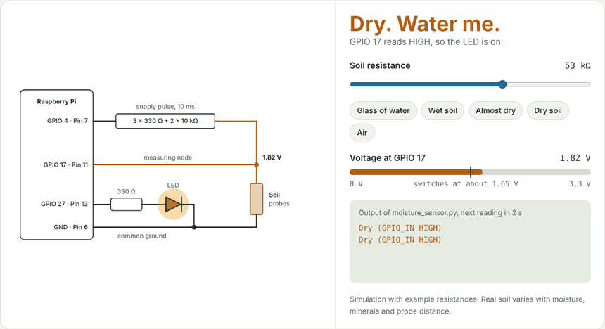
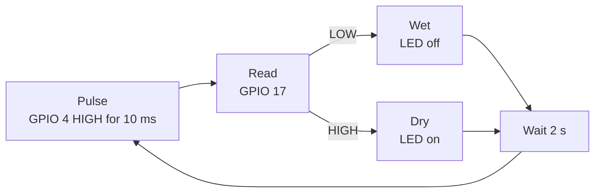

# 🌱 PlantPulse

**Never forget to water your plants again.** A Raspberry Pi, six resistors and one LED tell you when the soil is dry.

[](LICENSE)


[](https://nathanyiel.github.io/plantpulse/)

[](https://nathanyiel.github.io/plantpulse/)

*Click the preview to open the interactive guide in your browser.*

This project came out of the programming course during our vocational school and apprenticeship. It is small on purpose, so you can understand every part and build on it.

**Status:** finished school project, no longer maintained. Feel free to fork it and make it your own.

## How it works

Wet soil conducts electricity, dry soil hardly does. The Pi turns that into a yes or no with a voltage divider and one digital input. No extra chip is needed.




1. **Pulse.** GPIO 4 goes HIGH for 10 ms and powers the divider. The rest of the time no current flows through the probes, which slows corrosion.
2. **Read.** GPIO 17 reads the node between the resistors and the soil. Wet soil pulls it down to LOW. Dry soil lets it stay HIGH.
3. **React.** Dry: the LED lights up and the console prints `Dry`. Wet: the LED stays off and the console prints `Wet`. Then the Pi waits two seconds and starts again.

The soil is one half of the voltage divider, so its resistance decides the voltage at GPIO 17. Below about 1.65 V the pin reads LOW (wet), above it HIGH (dry):

| Soil | Resistance | Voltage at GPIO 17 | GPIO 17 reads | LED | Console |
| --- | ---: | ---: | :---: | :---: | --- |
| Glass of water | 2 kΩ | 0.28 V | LOW | off | `Wet (GPIO_IN LOW)` |
| Wet soil | 15 kΩ | 1.17 V | LOW | off | `Wet (GPIO_IN LOW)` |
| Almost dry | 33 kΩ | 1.61 V | LOW | off | `Wet (GPIO_IN LOW)` |
| **Switching point** | **about 36 kΩ** | **1.65 V** | | | |
| Dry soil | 120 kΩ | 2.07 V | HIGH | **on** | `Dry (GPIO_IN HIGH)` |
| Air | 500 kΩ | 2.26 V | HIGH | **on** | `Dry (GPIO_IN HIGH)` |

*Calculated with example resistances. Real soil varies with moisture, minerals and probe distance, and the switching point of a real input varies a little from Pi to Pi.*

## What you need

| Qty | Part | Note |
| --- | --- | --- |
| 1 | Raspberry Pi | Any model with the 40-pin header. The schematic was drawn for a Pi 2 B. |
| 3 | 330 Ω resistor | Upper part of the voltage divider |
| 2 | 10 kΩ resistor | Upper part of the voltage divider |
| 1 | 330 Ω resistor | In series with the LED |
| 1 | LED | |
| 2 | Metal probes | For example two nails or screws, or two wires with stripped ends |
| | Jumper wires | Optionally a breadboard |

## Wiring

| Pin | GPIO (BCM) | Job | Connects to |
| --- | --- | --- | --- |
| 7 | GPIO 4 | Supply pulse | Chain of 3 × 330 Ω and 2 × 10 kΩ in series, ending at the measuring node |
| 11 | GPIO 17 | Reads the node | Measuring node, directly |
| 13 | GPIO 27 | LED | 330 Ω, then the LED's long leg. The short leg goes to GND. |
| 6, 9, … | GND | Return path | Second soil probe and the LED's short leg |

The **measuring node** is the point where the resistor chain, GPIO 17 and the first soil probe meet. The original drawing is still in the repository: [assets/schematic.drawio.png](assets/schematic.drawio.png). It labels the ground connection “Pin 7”, but any GND pin works, for example 6 or 9.

<details>
<summary><b>Why these resistors?</b></summary>

<br>

The chain adds up to R<sub>top</sub> = 3 × 330 Ω + 2 × 10 kΩ ≈ 21 kΩ and forms the upper half of the voltage divider. The soil is the lower half, with the Pi's internal pull-down (about 50 kΩ) in parallel. With that, GPIO 17 flips from LOW to HIGH when the soil is around 36 kΩ.

If nothing lights up, check the LED direction first. The long leg points toward the resistor and GPIO 27. Always keep the 330 Ω resistor in the LED branch, or the LED draws too much current from the pin.

</details>

## Run it

Do this on the Raspberry Pi. On Windows or macOS you can edit the script, but the GPIO library only runs on a Pi.

Copy this whole block into a terminal. It installs the library, downloads the project and starts the sensor. Stop it with Ctrl+C.

```bash
sudo apt update && sudo apt install -y python3-rpi.gpio
git clone https://github.com/Nathanyiel/plantpulse.git
cd plantpulse
python3 moisture_sensor.py
```

**Raspberry Pi 5:** install `python3-rpi-lgpio` instead of `python3-rpi.gpio`. It is a drop-in replacement, so the script stays the same.

```bash
sudo apt update && sudo apt install -y python3-rpi-lgpio
```

**No git?** Download only the script:

```bash
curl -O https://raw.githubusercontent.com/Nathanyiel/plantpulse/main/moisture_sensor.py
python3 moisture_sensor.py
```

Example output:

```
Wet (GPIO_IN LOW)
Wet (GPIO_IN LOW)
Dry (GPIO_IN HIGH)
```

## The code

This is the complete script, [`moisture_sensor.py`](moisture_sensor.py). You can copy it as it is.

```python
import RPi.GPIO as GPIO
import time

GPIO.setmode(GPIO.BCM)

GPIO_OUT = 4    # Supplies the voltage divider briefly
GPIO_IN  = 17   # Reads the measuring node
GPIO_LED = 27   # LED indicator

# Setup
GPIO.setup(GPIO_OUT, GPIO.OUT, initial=GPIO.LOW)
GPIO.setup(GPIO_IN, GPIO.IN, pull_up_down=GPIO.PUD_DOWN)
GPIO.setup(GPIO_LED, GPIO.OUT, initial=GPIO.LOW)

def measure_once(pulse_ms=10):
    # Switch the supply on for a short moment
    GPIO.output(GPIO_OUT, GPIO.HIGH)
    time.sleep(pulse_ms/1000.0)      # e.g. 10 ms
    val = GPIO.input(GPIO_IN)        # 0 = LOW (wet), 1 = HIGH (dry)
    GPIO.output(GPIO_OUT, GPIO.LOW)
    return val

try:
    while True:
        v = measure_once(10)   # 10 ms pulse
        if v == 0:
            # LOW -> wet (the probes pull the node toward GND)
            GPIO.output(GPIO_LED, GPIO.LOW)   # LED off
            print("Wet (GPIO_IN LOW)")
        else:
            # HIGH -> dry: LED on as a warning
            GPIO.output(GPIO_LED, GPIO.HIGH)  # LED on
            print("Dry (GPIO_IN HIGH)")
        time.sleep(2.0)   # Measuring interval in seconds (adjustable)
finally:
    GPIO.cleanup()
```

| Part | What it does |
| --- | --- |
| Pins | BCM numbering, so these are GPIO numbers and not physical pin numbers. GPIO 4 sends the supply pulse, GPIO 17 reads the node, GPIO 27 drives the LED. |
| Setup | GPIO 4 and 27 are outputs and start LOW. GPIO 17 is an input with an internal pull-down, so it reads LOW unless the divider pushes it high. |
| `measure_once()` | Switches the divider on, waits 10 ms, reads GPIO 17, switches the divider off and returns `0` (wet) or `1` (dry). |
| Main loop | Measures, sets the LED, prints a line and sleeps two seconds. Change the interval in the last `time.sleep(2.0)`. |
| `GPIO.cleanup()` | Runs when you press Ctrl+C and resets the pins. |

## Troubleshooting

| Problem | What to check |
| --- | --- |
| `RuntimeError` about the Raspberry Pi or a missing `RPi` module | The script only runs on a Raspberry Pi with the GPIO library installed. |
| Always prints `Dry` | Both probes in the soil? GND connected? Probes not too far apart? |
| Always prints `Wet` | Probes touching each other? Is the resistor chain connected to GPIO 4? |
| LED never lights up | LED direction (long leg toward GPIO 27), and the 330 Ω resistor in the LED branch. |

## Take it further

- Log the readings with a timestamp to a CSV file and plot how fast your plant dries out.
- Send a push message or email when the soil has been dry several readings in a row.
- Add an analog-to-digital converter such as the MCP3008 to get a percentage instead of wet or dry.
- Drive a small pump through a relay or transistor to water automatically.
- Run the script as a systemd service so it starts on boot.
- Repeat the divider on more GPIO pins to watch several plants.

## Credits

Built by [@lebor32](https://github.com/lebor32) and [@Nathanyiel](https://github.com/Nathanyiel). Released under the [MIT license](LICENSE).
